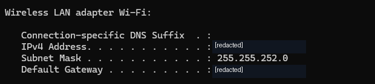
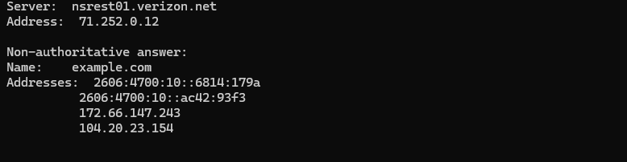
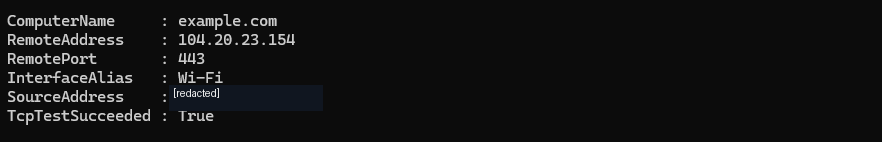

# Windows Network Troubleshooting | Home Lab 01

**Author:** Jose Nava  
**Completed:** November 9, 2026  
**Environment:** Windows laptop, Wi-Fi, Windows Command Prompt, Windows PowerShell  
**Cost:** $0 — built-in Windows tools

## Project overview

Performed a seven-step Windows network-health assessment to practice the diagnostic workflow of a Tier 1 IT help desk technician. Used command-line tools to examine network configuration and test local connectivity, external IP reachability, DNS resolution, and TCP port accessibility.

**Scope:** Independent training project. No real customer outage was investigated, and no repair or configuration change was required.

## Test results

| # | Tool or command | Observed result | Evidence |
|---|---|---|---|
| 1 | `ipconfig` | Wi-Fi IPv4 address, `/22` subnet mask, and default gateway displayed | [Screenshot 01](01_wifi_configuration_redacted.png) |
| 2 | `ipconfig /all` | DHCP enabled; DNS server addresses configured | Reported during lab; no screenshot |
| 3 | `ping 127.0.0.1` | 4 replies, 0% packet loss | Reported during lab; no screenshot |
| 4 | `ping <default-gateway>` | 4 replies, 0% packet loss; average 3 ms | [Screenshot 02](02_gateway_ping.png) |
| 5 | `ping 1.1.1.1` | 4 replies, 0% packet loss; average 8 ms | [Screenshot 03](03_external_ping.png) |
| 6 | `nslookup example.com` | IPv4 and IPv6 addresses returned | [Screenshot 04](04_dns_lookup.png) |
| 7 | `Test-NetConnection example.com -Port 443` | `TcpTestSucceeded: True` | [Screenshot 05](05_tcp_port_443_redacted.png) |

**Outcome:** Every tested function produced the expected result. No network fault was identified in these checks.

## Project documents

- [Evidence report (PDF)](Jose_Nava_Network_Home_Lab_Evidence_Report.pdf)
- [Editable evidence report (Word)](Jose_Nava_Network_Home_Lab_Evidence_Report.docx)
- [Troubleshooting worksheet (TXT)](IT_Lab_01_Network_Worksheet.txt)

## Screenshot evidence

Select a test below to view its redacted screenshot.

<strong>01 — Wi-Fi IP configuration</strong>

<strong>02 — Default gateway ping: 0% loss</strong>

<strong>03 — External IP ping: 0% loss</strong>

<strong>04 — DNS lookup: IPv4 and IPv6 results</strong>

<strong>05 — TCP port 443 connection: successful</strong>

## Simulated help desk ticket

**Request:** Confirm that a Windows laptop has valid network settings and can reach local and external resources.

**Actions:** Reviewed Wi-Fi configuration and DHCP/DNS settings; tested TCP/IP loopback, router reachability, external IP connectivity, DNS lookup, and remote TCP port 443.

**Resolution / disposition:** All seven checks passed. No changes were necessary. Results and evidence were documented.

## Key technical lessons

- An assigned IP address and default gateway do not by themselves prove connectivity.
- Successful gateway and public-IP pings provide evidence of ICMP reachability, but they do not verify every network service.
- DNS resolution and TCP port reachability are separate tests.
- `TcpTestSucceeded: True` confirms a TCP connection to port 443, not a complete browser session or TLS certificate validation.

## Skills demonstrated

Windows Command Prompt · PowerShell · TCP/IP · IPv4 · DHCP configuration review · DNS · ICMP · `ping` · `nslookup` · `Test-NetConnection` · test documentation · entry-level troubleshooting

## Privacy and evidence notes

Screenshots are from the actual lab. For public sharing, the Windows account prompt and selected private network details were obscured. The test measurements and results were not altered. DHCP and loopback results were recorded during the guided lab but do not have supporting screenshots.
